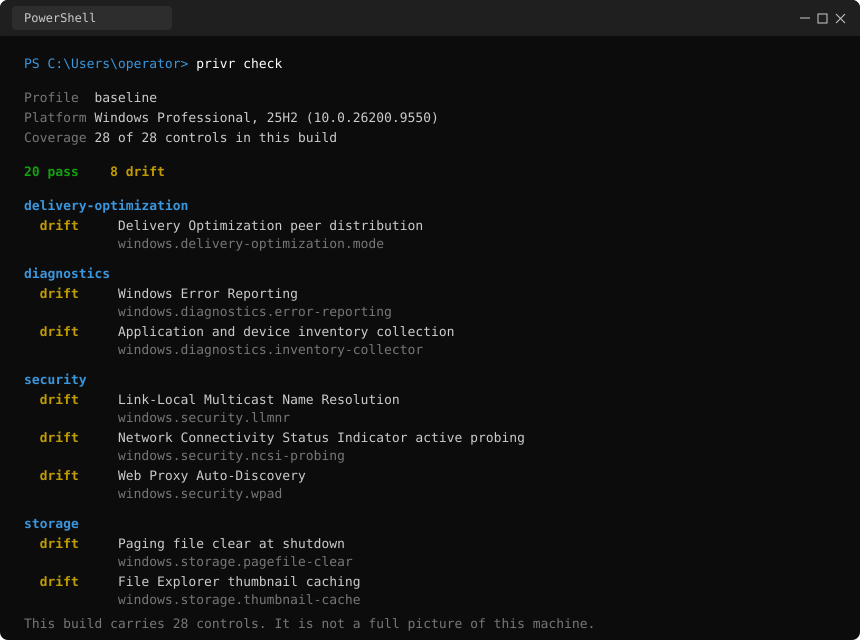
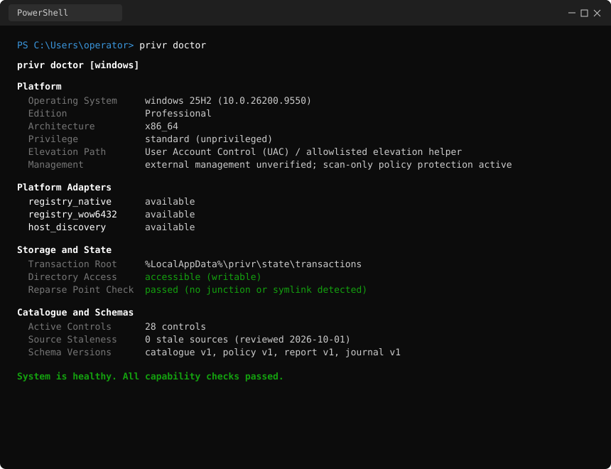
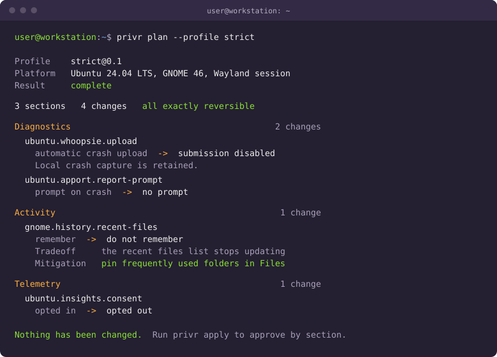
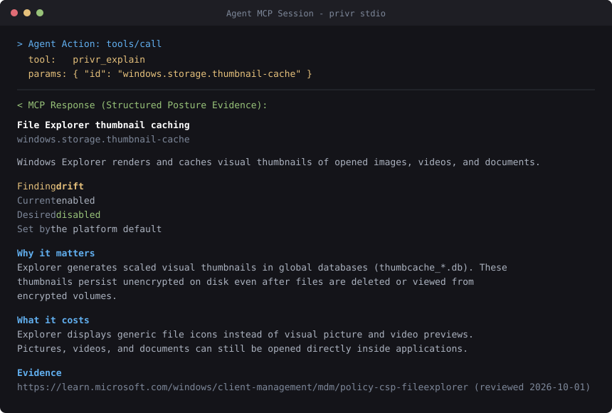

# privr

Privacy settings you can verify.

`privr` is a local-first privacy posture CLI. It reads which optional
data-sharing settings are actually in effect, explains the evidence and the
tradeoffs, applies a policy in reviewable steps, and can reverse what it
changed.

It is built for individuals and power users on machines they own: developers,
security-minded people, anyone running sensitive work or local models on their
own hardware. It is not a device-management product and does not compete with
one.

Every command produces stable text and versioned JSON, works offline, and is
designed to be driven by an agent harness as readily as by a person.

## Status

- **Windows `check`, `explain`, `list`, `doctor`, `recommend`, `simulate`, `plan`, `apply`, `history`, and `rollback` are implemented**, with 31 controls across 5 posture dimensions (verified through Windows 11 24H2 and 26H2 build 26300), rollback journaling, and native UAC elevation handling. When drift is present, a terminal offers `[y] apply safe fixes, [d] preview diff, [e] explain score & critical items, [q] quit`. An incomplete check with no drift asks what could not be checked. CLI aliases (`status`, `scan`, `diff`, `fix`, `harden`, `undo`, `log`) still work. Release blockers remain in the roadmap.
- **Defensive and adaptive application**: `plan` and `apply` accept `--workload` (`general`, `developer`, `creative`, `mobile`, `high-assurance`) and `--max-friction`. When run unprivileged, batch operations apply eligible user-scope controls and report deferred machine-scope controls without failure.
- **Linux and macOS `check` are experimental** with typed elevation metadata, tested in CI across multiple platforms.
- **Mac analytics sharing remains Unknown**. Diagnostic history cannot establish
  its effective preference or management source. A supported preference reader
  and native macOS validation remain required; the control is audit-only.
- **Systemd storage files describe configured intent only**. Bounded main-file
  and drop-in reads explain that intent; coredump and journald storage remain
  Unknown until loaded state can be attested. See [the evidence limits](docs/SYSTEMD_EVIDENCE.md).
- **A missing thumbnail cache and the legacy KDE feedback file do not pass**.
  The FreeDesktop directory stores generated previews. Plasma stores
  `FeedbackLevel` in `PlasmaUserFeedback`, and the administrator force-off
  file is separate. Neither reading is treated as caching or telemetry off.
- **Popularity-contest merges the full 1.79 configuration chain**. When
  `/usr/sbin/popularity-contest` is absent, the daily job exits without
  submitting and the control passes. When installed, `PARTICIPATE` is merged
  across `/usr/share/popularity-contest/default.conf`,
  `/etc/popularity-contest.conf`, and `/etc/popularity-contest.d/*.conf`; a
  single file without the package default and drop-in layers stays unknown.
- **A masked fstrim unit does not pass**. A wants symlink is enablement only
  when the unit file systemd would load is non-empty. An empty unit file,
  including a link to the null device, stays drift.
- **A stopped avahi-daemon does not pass**. `systemctl is-active` reports
  whether the process is running. It does not disable publishing.
  `disable-publishing` defaults to no and `publish-addresses` defaults to
  yes, so a stopped daemon with those defaults stays unknown.
- **Check completeness follows the selected scope**. Zero evaluated controls are incomplete (exit 3), even when every result is not applicable or not selected. CLI and MCP selectors share the compiled report builder; hiding passing rows does not change summary counts. See [report semantics](docs/RESULTS.md#completeness).
- **First-run output keeps uncertainty visible**. The headline leads with
  unknown, unchecked, and error counts, then how many evaluated controls pass.
  It is not a score. A dimension percentage covers evaluated controls only.
  Recommendations examine the eligible catalogue across profiles, while
  `check` defaults to baseline. An empty recommendation list is not a compliance
  result. Overview examples come from the platform's compiled catalogue.
- **Check reports are schema 2**. A saved check keeps the reduced observation
  (policy mode, desired state, observed state or a typed reason, basis, and
  confidence) and the compiled source table. It does not keep raw evidence.
  `explain` is a fresh read and says so. Plan, apply, rollback, recommend,
  simulate, and journal records stay schema 1.
- **File-based probe replay covers Windows controls** (advertising ID, Copilot shell integration, Recall snapshots, diagnostic data, LLMNR name resolution, WPAD auto-discovery, thumbnail caching, tailored experiences, web search, and delivery optimization) across 96 synthetic observation states. Synthetic observations exercise the compiled probes and evaluator; native captures and full per-control coverage remain release blockers.
- **Custom policy engine is implemented**: `check`, `plan`, and `apply` accept `--policy <FILE>` supporting schema 1 TOML and JSON formats. Policies extend built-in profiles (`baseline`, `strict`, `restrictive`), allow per-control mode and desired-state overrides, and support ISO-dated exceptions (`[[exceptions]]`). Active exceptions are distinguished from absent risk in posture reports and safely excluded from automated remediation until expiry.
- **Agent integration (`privr mcp`) is implemented**, providing a stdio Model Context Protocol (MCP) server exposing `privr_check` (with post-update regression comparison), `privr_plan`, `privr_apply`, `privr_recommend`, `privr_simulate`, `privr_explain`, `privr_clean`, `privr_history`, and `privr_doctor` with Agent Plugins v1.0.0 packaging.

Cleanup remains experimental. Journals now track per-target totals and explicit
completion or interruption; Linux signal tests cover partial cleanup. Broader
native target and cancellation validation remain outstanding. See the known
issues below before using deletion workflows.

The full state, including known defects, is in
[ROADMAP.md](ROADMAP.md#current-state).





On the machine this was developed on, one control found something real:

```text
diagnostics
  pass      Diagnostic data level
            windows.diagnostics.level
            A level of 0 is configured, but this Windows edition does not honor it.
            Microsoft documents value 0 as applying only to Enterprise, Education,
            and Server, and as equivalent to 1 elsewhere. This machine sends
            required diagnostic data.
```

Something had set `AllowTelemetry = 0` on a Windows Professional machine. A
checker that interprets only that configured value could report telemetry as
disabled. It is not. The `pass` above means the effective required-only level
matches the selected policy; it does not mean diagnostic transmission is off.

What is designed but not built: complete per-control fixtures and signed releases.
Interactive section approval is implemented (`privr apply -i`,
`--interactive-sections`, or `[s]` in the interactive prompt), treating an intentional stop
after approving sections as verified success. Rollback supports section-granular
reversion (`privr rollback --section <section>`). Noninteractive batch runs require
explicit risk acceptance (`--accept-risk <id>` or `--force`) for high-friction controls.
PowerShell session-only history is implemented as a guided review control
(`windows.shell.history-persistence`) and architectural walkthrough (`privr explain shell`),
with [its scope and tradeoffs](docs/PRIVACY_RESIDUE.md#shell-command-histories) documented.
Privacy cleanup is implemented (`privr clean`, alias `privr purge`), thorough by
default across supported caches, temporary residue, recent-file lists, and saved
PowerShell ConsoleHost history. One preview and confirmation approves permanent
deletion; `--yes` confirms it in scripts. Close affected applications first,
because they can recreate records. `--polite` offers reduced cleanup. Browser
cookies, browser history, and site/session storage are not implemented targets
yet. Actual user content and recovery material remain outside routine cleanup.
See [cleanup scope and limits](docs/CLI.md#clean-alias-purge).

## Where it is going

`plan` previews configuration changes without applying them. Section-by-section
approval is implemented in `apply`. The illustration below shows a proposed
presentation of those changes and their tradeoffs, not current terminal output.



The image is a presentation mockup, unlike the captured output above it.

Local retention matters too. PowerShell guidance recommends session-only
command history, keeping recall in the current shell without saving new
PSReadLine history across sessions. It discloses the loss of cross-session recall. Bounded retention needs further research. Existing ConsoleHost history cleanup
is a separate `clean` target; security logs remain outside both workflows.
Predictive suggestions are a separate option. See the
[roadmap](ROADMAP.md#powershell-session-only-history-planned).

## Why this exists

Consider a setting that many Windows privacy tools change.

`AllowTelemetry = 0` is documented by Microsoft as applying only to Enterprise,
Education, and Server editions. On Home and Pro, Microsoft states that using it
is "equivalent to setting the value of 1"
([Policy CSP - System](https://learn.microsoft.com/windows/client-management/mdm/policy-csp-system)).

So on the most common editions of Windows the write succeeds, the value reads
back as `0`, a checker can mistake that configured value for effective refusal,
and the diagnostic level remains required-only. The write alone does not prove
the claimed privacy effect.

That is not an unusual case. Several widely applied policy values are silently
inert outside Enterprise and Education, and comparable traps exist on the other
platforms: a macOS preference read without the right permission can return a
value from a stale file rather than failing, and a Fedora setting written in the
main configuration file is overridden per repository.

`privr` exists to answer four questions without guessing:

1. What is this machine configured to share?
2. Which settings differ from the policy I selected?
3. What does each choice cost me in privacy, security, and functionality?
4. Can a change be applied and reversed without surprises?

The goal is not the longest list of tweaks. It is a smaller catalogue that is
cited, version-aware, and honest about what it does not know.

## Install

Building from source is currently the only path. Rust 1.99 or later. If Cargo
says a newer compiler is required, run `rustup update stable`.

```bash
git clone https://github.com/blisspixel/privr
cd privr
cargo build --locked --release
```

The executable is `target/release/privr` (`target\release\privr.exe` on
Windows). Run it directly before installing:

```bash
./target/release/privr check
```

On PowerShell, use `.\target\release\privr.exe check`. To install the binary
from this checkout so that `privr` can be called from another directory:

```bash
cargo install --locked --path .
```

Cargo installs into `$CARGO_HOME/bin`, usually `~/.cargo/bin` (on Windows,
`%USERPROFILE%\.cargo\bin`). Ensure that directory is on your shell's `PATH`;
if it is not, use the built executable directly or add Cargo's bin directory
to your shell configuration.

One-line installers and package manager entries ship with the first signed
release. The installer will place an unprivileged binary and nothing else;
`privr` requests elevation only at apply time, after showing you the plan.
GitHub source tags are maintenance snapshots of `main`. They are not the
0.1.0 Windows release, and they are not signed binaries.

## Workflow

```text
check -> explain -> recommend -> simulate -> plan -> apply -> verify -> rollback
```

This is the canonical workflow. On Windows, all commands in the lifecycle are
implemented. Mutation remains experimental until the roadmap's release
requirements are met; see [Current state](ROADMAP.md#current-state) for testing
and validation limits:

```text
privr check (or privr scan, privr status)
privr explain windows.advertising.id
privr recommend --workload developer
privr simulate --profile baseline
privr plan (or privr diff)
privr apply (or privr fix)
privr history (or privr log)
privr undo (or privr rollback)
privr clean (or privr purge)
```

- `doctor` reports host facts, implemented elevation paths, compiled adapters,
  transaction storage checks, and schema versions. A compiled adapter does not
  attest live service capability. Linux privilege comes from the effective UID;
  Windows editions are not applicable there, and a known rolling-distribution ID
  remains visible even when its numeric version is unknown.
- `check` (aliases: `status`, `scan`, `audit`) reads effective state and compares it against a policy across five posture dimensions (behavioral-commercial, forensic-residue, network-exposure, diagnostic-crash, ambient-sensor). Passing `--compare <SAVED_REPORT.json>` evaluates live state against a historical report to detect regressions, newly applicable controls, and platform changes after OS or component updates.
- `explain` without arguments (or with `score`, `critical`, `posture`) walks through the posture calculation, five dimensions, four friction tiers, and critical controls; `explain storage` details physical flash mechanics, FTL wear leveling, hardware TRIM unmapping, and NIST SP 800-88 sanitization standards; `explain shell` details PSReadLine, Bash, and Zsh credential leakage and session-only history configuration; `explain residue` details forensic logging, polite vs aggressive modes, and scientific sanitization; passing an exact ID shows technical evidence, applicability, management source, and tradeoffs.
- `recommend` examines the full eligible compiled catalogue across profiles,
  then filters confirmed drift by workload and optional dimension/friction
  constraints. It does not default to baseline. Recommendations are ordered by
  friction tier (Tier 0 transparent to Tier 3 incompatible/tradeoff); unknown
  evidence and excluded controls cannot establish compliance.
- `simulate` performs a dry-run counterfactual posture vector projection without mutating host state, reporting transition deltas, friction counts, and reboot or signout requirements.
- `plan` (alias: `diff`) is read-only and shows the exact eligible change set. Running `privr plan` without arguments defaults to the daily-driver general persona and cosmetic friction ceiling.
- `apply` (aliases: `fix`, `harden`) executes safe, verified remediation with transaction journaling, interactive plan review, section-by-section approval (`-i, --interactive-sections`), and native in-place elevation (`-e, --elevate`). Running `privr apply` without arguments is limited to Tier 0 and Tier 1 (transparent and cosmetic) daily-driver controls. Confirmation defaults to no; interactive mode offers whole-batch approval (`[y]`), section-by-section review (`[s]`), detailed diff (`[d]`), or cancelling (`[q]`). Stopping partway is treated as verified success (`stopped X sections applied, Y deferred`). A non-interactive shell must pass `--yes` after `privr plan`.
- `history` (alias: `log`) lists previous transactions, timestamps, applied control counts, and profiles. Running `privr history --purge` (with `-y / --yes`) permanently purges and destroys transaction records from disk.
- `rollback` (aliases: `restore`, `undo`) restores exact prior values. Running `privr undo` without arguments automatically targets the most recent transaction recorded on disk.
- `clean` (alias: `purge`) removes the supported privacy residue described above. Review with `clean --preview`, then confirm interactively or use `clean --yes`. History deletion is irreversible. `--polite` reduces scope; `--category` and `--control` narrow it. `--trim` requests separate free-space maintenance, not secure erasure.

The full command and exit-code contract is in [docs/CLI.md](docs/CLI.md).

## Agents
 
`privr` is designed to be driven by an agent harness from the first release,
whether that is a coding assistant, a hosted model, or a local one. A direct
stdio server is implemented at `privr mcp`, alongside packaging for the open
[Agent Plugins](https://agent-plugins.org/) standard (`plugin.json`, `mcp.json`,
and `skills/privr/SKILL.md`).

- Read-only tool access (`privr_status`, `privr_doctor`, `privr_catalog`,
  `privr_check` with post-update comparison, `privr_explain`, `privr_plan`,
  `privr_recommend`, `privr_simulate`, `privr_history`, and preview mode for
  `privr_clean`) over stdio, so an agent can inspect, simulate, and propose without
  being able to change anything.
- Mutating tools (`privr_apply`, `privr_rollback`, `privr_clean` purge, and
  `privr_history` purge) require `--allow-apply` and explicit `yes: true` confirmation,
  and approval cannot be granted through an unconfirmed tool call.
- Result objects are self-contained and ordered deterministically, with
  verbosity tiers so a full report fits a small context window.
- Reports carry no stable machine identifier, so a report is safe to hand to a
  model.



`privr` never calls a language model itself. The model is always the caller,

never a dependency, and normal operation stays offline.

## Safety

These are the release requirements. The experimental `apply` and `rollback` do
not yet meet all of them; see [ROADMAP.md](ROADMAP.md#current-state).

- No product telemetry, and no network requirement for normal operation.
- No arbitrary shell commands in profiles or catalogue data.
- No mutation without a fresh plan and a check immediately before each write.
- No rollback that silently overwrites a later external change.
- No unknown, unreadable, or unsupported result reported as a pass.
- No clearing of logs, deleting of cloud data, disabling of updates, or removal
  of encryption as ordinary remediation.
- No promise of anonymity. Configuring a machine for minimal sharing does not
  make it unobserved, and on some platforms the configuration state itself is
  reported.

See [docs/SAFETY.md](docs/SAFETY.md) and
[docs/THREAT_MODEL.md](docs/THREAT_MODEL.md).

## Documentation

- [Design decisions](docs/DECISIONS.md)
- [Product definition](docs/PRODUCT.md)
- [CLI contract](docs/CLI.md)
- [Agent interface](docs/AGENT_INTERFACE.md)
- [Policy model](docs/POLICY.md)
- [Result and drift model](docs/RESULTS.md)
- [Control contribution standard](docs/CONTROL_STANDARD.md)
- [Platform findings](docs/PLATFORM_SUPPORT.md)
- [Architecture](docs/ARCHITECTURE.md)
- [Maintenance policy](docs/MAINTENANCE.md)
- [Safety model](docs/SAFETY.md)
- [Threat model](docs/THREAT_MODEL.md)
- [Privacy behavior](docs/PRIVACY.md)
- [Privacy residue and erasure](docs/PRIVACY_RESIDUE.md)
- [Privacy cache capability plan](docs/CACHE_PRIVACY_PLAN.md)
- [Testing strategy](docs/TESTING.md)
- [Supply-chain security](docs/SUPPLY_CHAIN.md)
- [Research notes](docs/RESEARCH.md)
- [Contribution guide](CONTRIBUTING.md)

## Contributing

Early contributions should improve evidence and correctness: primary vendor
sources, compatibility findings, redacted fixtures, effective-state logic,
failure tests, and rollback tests. A setting does not become supported because
it appears in a tweak script.

Read [CONTRIBUTING.md](CONTRIBUTING.md) and [AGENTS.md](AGENTS.md) before making
changes.

## License

Apache-2.0. See [LICENSE](LICENSE).
